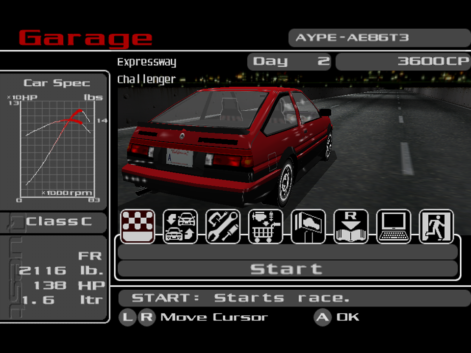

# Tokyo Xtreme Racer 2 Native Port

**Tokyo Xtreme Racer 2 Native Port** is an unofficial fan project by Tofuman.
Tofuman and this project are unaffiliated with Genki. This is a bring-your-own-ROM
release. No original game assets are distributed.

## Native C++ engine

TXR2 Port runs natively in C++20 on Windows and Linux without Dreamcast CPU
emulation. These examples are taken directly from the production game code.

<details>
<summary>Buying car upgrades</summary>

The parts shop checks availability, existing ownership and credits before granting a part.

[Source](https://github.com/tofuman0/TXR2-Port/blob/aa2a42ae12cdc7fba4f5a273aca38bd38a5b38c0/src/quest_parts_stock.cpp#L848)

```cpp
QuestPartPurchaseResult QuestPartsSession::Buy(QuestPartSelection selection,
    std::span<uint8_t, QuestProgressBlockBytes> progress)
{
    const auto offer = GetOffer(selection);
    if (!offer)
    {
        return QuestPartPurchaseResult::Unavailable;
    }
    if (offer->m_Owned)
    {
        return QuestPartPurchaseResult::AlreadyOwned;
    }

    if (!DeductCredits(progress, offer->m_Price))
    {
        return QuestPartPurchaseResult::InsufficientCredits;
    }
    return Grant(selection);
}
```

</details>

<details>
<summary>Previewing modifications safely</summary>

The garage applies the candidate part to a copy, keeping the fitted car unchanged until the player confirms.

[Source](https://github.com/tofuman0/TXR2-Port/blob/aa2a42ae12cdc7fba4f5a273aca38bd38a5b38c0/src/quest_parts_stock.cpp#L1169)

```cpp
std::optional<QuestCarRecord> QuestPartsSession::GetPartPreview(QuestPartSelection selection,
    std::optional<uint8_t> wheelSetting) const
{
    if (!GetOffer(selection) || (wheelSetting && (!IsWheel(selection) || *wheelSetting > 4)))
    {
        return {};
    }

    // 061480 temporarily applies the candidate to the workspace and
    // restores the fitted state after updating the preview.
    auto preview = m_Car;
    const auto& fields = *FindPartFields(selection);
    preview.m_Bytes[fields.m_Installed] = static_cast<uint8_t>(selection.m_Variant);
    if (wheelSetting)
    {
        preview.m_Bytes[WheelOffset] = *wheelSetting;
    }
    return preview;
}
```

</details>

<details>
<summary>Battle rewards</summary>

Battle payouts combine remaining SP, distance, rival priority and encounter history using the recovered game rules.

[Source](https://github.com/tofuman0/TXR2-Port/blob/aa2a42ae12cdc7fba4f5a273aca38bd38a5b38c0/src/battle.cpp#L138)

```cpp
BattleAward Battle::CalculateAward(const BattleResult& result, const BattleAwardRules& rules)
{
    constexpr std::array TypeMultipliers{ 0, 1, 2, 3, 3, 4, 5, 3, 0, 0 }; // 0B54C8
    const int32_t typeIndex = -int32_t(rules.m_RivalType);
    if (typeIndex < 0 || static_cast<std::size_t>(typeIndex) >= TypeMultipliers.size() ||
        result.m_PlayerSp < 0 || result.m_PlayerSp > 5000000)
    {
        throw std::invalid_argument("Invalid battle award rival type or SP");
    }

    const auto components = CalculateAwardComponents(result.m_Distance, result.m_PlayerSp,
        result.m_Outcome == BattleOutcome::Win);
    BattleAward award{};
    award.m_SpThousandths = components.m_SpThousandths;
    award.m_SpComponent = components.m_SpComponent;
    award.m_RawDistance = components.m_RawDistance;
    award.m_DistanceComponent = components.m_DistanceComponent;
    if (result.m_Outcome == BattleOutcome::Win)
    {
        award.m_ResultMultiplier = rules.m_Defeated ? 2 : rules.m_Encountered ? 4 : 5;
    }

    award.m_RivalComponent = (int32_t(rules.m_RivalPriority) + 1) * 2000;
    award.m_AdjustedSpComponent =
        static_cast<int32_t>(float(award.m_SpComponent) * (rules.m_SpBonus ? 1.5f : 1.0f)) / 100 * 100;
    award.m_TypeMultiplier = TypeMultipliers[static_cast<std::size_t>(typeIndex)];
    const float total = std::fma(float(award.m_RivalComponent), float(award.m_ResultMultiplier),
        float(award.m_AdjustedSpComponent)) + float(award.m_DistanceComponent);
    award.m_Cp = (static_cast<int32_t>(total) / 100) * award.m_TypeMultiplier;
    return award;
}
```

</details>

## Documentation

Explore cars, rivals, courses, and game mechanics in the [TXR2 documentation](https://tofuman0.github.io/txr2-documentation/).

## Downloads

Version **2026.0.6.287**
Built from [source revision aa2a42ae](https://github.com/tofuman0/TXR2-Port/commit/aa2a42ae12cdc7fba4f5a273aca38bd38a5b38c0).

| Platform | ZIP | SHA-256 |
| --- | --- | --- |
| Windows x64 | [txr2-2026.0.6.287-Windows-x64.zip](downloads/txr2-2026.0.6.287-Windows-x64.zip) | `8126a69bbbf5d75a5d5fbbd3a99ec78eb71b0ddecb4c3d522c5f980bf41ca2fd` |
| Linux x64 | [txr2-2026.0.6.287-Linux-x64.zip](downloads/txr2-2026.0.6.287-Linux-x64.zip) | `1a44ed626c6a4da688c1bca70afee420c9b99ee34b13bca27a4eb7963f369156` |

## This build

- Application-owned Vulkan renderer with loading, menu and pause fixes.
- Grouped graphics settings, Vehicle Detail levels and scrolling Graphics Test controls.
- Model-viewer numeric selection, factory colours, traffic styles and workshop fixes.
- Corrected light/depth handling and rear-weighted car motion blur.
- Windows and Linux Release startup checks passed without `1ST_READ.BIN` or `IP.BIN`. Linux was checked under WSL; no performance benchmarks were run.

## Getting started

Download and extract the ZIP for your operating system. Place your own extracted
game files directly in `data` beside the executable. The bundled Dreamcast
Disc Extractor is in `Disc Extractor`. Choose your disc image as ROM In and
the game's `data` folder as Data Out. Use the supported US
Dreamcast release `T40211N V1.002`. The port runs without `1ST_READ.BIN` or `IP.BIN`.
Launch `txr2.exe` on Windows or `./txr2` on
Linux. A Vulkan-capable graphics driver is required. Linux also requires the OpenSSL 3 runtime (`libcrypto.so.3`). To use a different folder,
pass `--rom-dir <path>`.

## Command-line arguments

| Arguments | Purpose |
| --- | --- |
| `--rom-dir <path>` | Use extracted game files from a different folder. |
| `--settings <path>` | Use a different settings file. |
| `--log-level error\|info\|verbose` | Set logging detail. Release defaults to `error`. |
| `--cheats-enabled` | Enable test cheats, including hold 1 or 2 for hyperspeed. |
| `--help`, `--platform-smoke` | Print usage or run platform diagnostics. Use alone. |
| `--validate`, `--list-resources`, `--resource-id <decimal-or-hex>` | Validate game files, list resources or inspect a resource. Choose one operation. |
| `--graphics-test`, `--graphics-test-motion` | Open Graphics Test in its standard or repeatable motion mode. |
| `--graphics-test-seed <N>`, `--graphics-test-frames <N>` | Set the test seed or stop after a fixed number of frames. |
| `--capture <image.png>` | Write a PNG capture in a supported test mode. |
| `--battle-entrance-test` | Open the battle entrance diagnostic. |
| `--preview-quest-reveal` | Play the standalone Quest reveal. |
| `--title-frames <N>` | Limit title frames for automated testing. |
| `--frontend-script <path>`, `--frontend-capture-dir <path>` | Run scripted frontend input and set its PNG output folder. |
| `--startup-capture-dir <path>`, `--startup-report-dir <path>` | Set startup test capture and report folders. |
| `--startup-test-delay-ms <N>`, `--startup-test-quit-ms <N>` | Delay startup preparation or quit after a test interval. |
| `--play`, `--preview-quest-course` | Compatibility flags. Both allow normal startup. |

In Quick Race, press F7 during GO to use instant win with cheats enabled.
Using it marks the run as cheated.

In Graphics Test, F10 toggles the fixed Genki reflection target in the
adjacent lane. The target starts hidden.

## Screenshots





