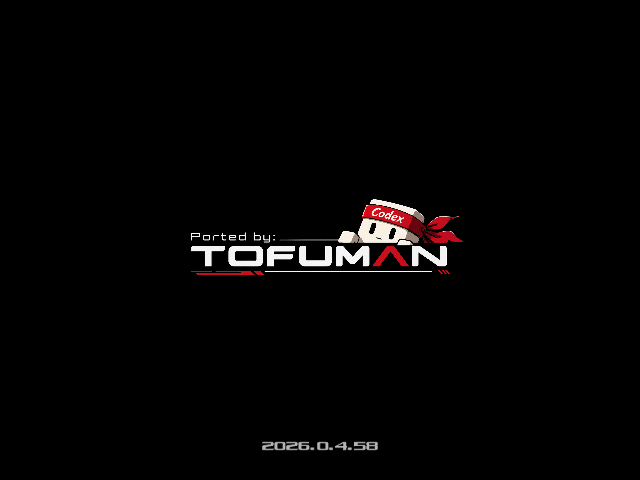
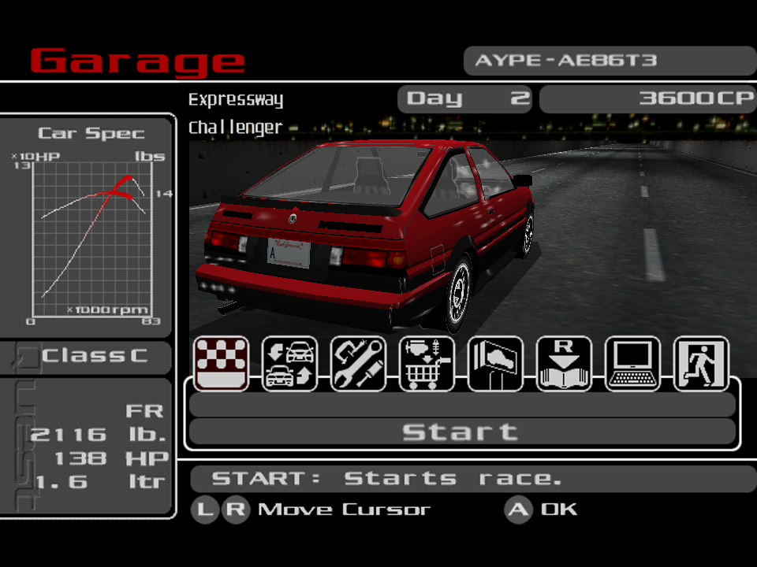
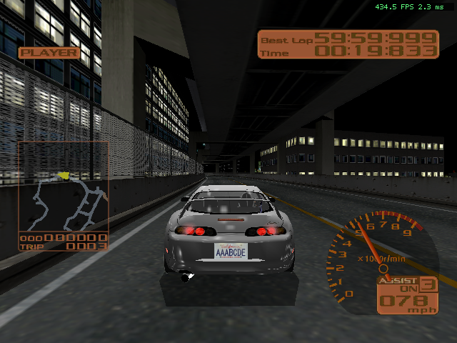

# Tokyo Xtreme Racer 2 Native Port

**Tokyo Xtreme Racer 2 Native Port** is an unofficial fan project by Tofuman.
Tofuman and this project are unaffiliated with Genki. This is a bring-your-own-ROM
release. No original game assets are distributed.

## Native C++ engine

TXR2 Port runs natively in C++20 on Windows and Linux without Dreamcast CPU
emulation. The racing engine uses typed vehicle data and simulation state.
This function validates the current gear state, applies automatic gear selection
to a copy, and writes back the result once the update succeeds.

```cpp
void RaceEngineTables::SelectAutomaticGear(
    RaceEngineState& state,
    const RaceEngineCarInfo& car) const
{
    ValidateGearState(state);
    auto next = state;
    AutomaticGear(next, car);
    state = next;
}
```

## Downloads

Version **2026.0.5.134**
Built from [source revision 28b400c](https://github.com/tofuman0/TXR2-Port/commit/28b400c18bbd7ce43f498e81687205c4ac98392e).

| Platform | ZIP | SHA-256 |
| --- | --- | --- |
| Windows x64 | [txr2-2026.0.5.134-Windows-x64.zip](downloads/txr2-2026.0.5.134-Windows-x64.zip) | `a8e7da3c69bbd6149ce89210f17fe3a7fb2eb4702e9b0135dec503423162538a` |
| Linux x64 | [txr2-2026.0.5.134-Linux-x64.zip](downloads/txr2-2026.0.5.134-Linux-x64.zip) | `9ecb47aee1bfbd6eff8a89b971f0a78d0e5eff44dd6a6d8d15d17b326e91016e` |

## This build

- `IP.BIN` is optional; the port uses the selected data folder and assumes supported game data.

## Getting started

Download and extract the ZIP for your operating system. Place your own extracted
game files directly in `data` beside the executable. The bundled Dreamcast
Disc Extractor is in `Disc Extractor`. Choose your disc image as ROM In and
the game's `data` folder as Data Out. Use the supported US
Dreamcast release `T40211N V1.002`. The port runs without `1ST_READ.BIN` or `IP.BIN`.
Launch `txr2.exe` on Windows or `./txr2` on
Linux. A Vulkan-capable graphics driver is required. To use a different folder,
pass `--rom-dir <path>`.

## Command-line arguments

| Arguments | Purpose |
| --- | --- |
| `--rom-dir <path>` | Use extracted game files from a different folder. |
| `--settings <path>` | Use a different settings file. |
| `--log-level error\|info\|verbose` | Set logging detail. Release defaults to `error`. |
| `--cheats-enabled` | Enable test cheats, including hold 1 or 2 for hyperspeed. |
| `--help`, `--platform-smoke` | Print usage or run platform diagnostics. Use alone. |
| `--validate`, `--list-resources`, `--resource-id <decimal-or-hex>` | Validate game files, list resources or inspect a resource. Choose one operation. |
| `--graphics-test`, `--graphics-test-motion` | Open Graphics Test in its standard or repeatable motion mode. |
| `--graphics-test-seed <N>`, `--graphics-test-frames <N>` | Set the test seed or stop after a fixed number of frames. |
| `--capture <image.png>` | Write a PNG capture in a supported test mode. |
| `--preview-quest-reveal` | Play the standalone Quest reveal. |
| `--title-frames <N>` | Limit title frames for automated testing. |
| `--frontend-script <path>`, `--frontend-capture-dir <path>` | Run scripted frontend input and set its PNG output folder. |
| `--startup-capture-dir <path>`, `--startup-report-dir <path>` | Set startup test capture and report folders. |
| `--startup-test-delay-ms <N>`, `--startup-test-quit-ms <N>` | Delay startup preparation or quit after a test interval. |
| `--play`, `--preview-quest-course` | Compatibility flags. Both allow normal startup. |

## Documentation

The [TXR2 documentation repository](https://github.com/tofuman0/txr2-documentation) is planned.

In Quick Race, press F7 during GO to use instant win with cheats enabled.
Using it marks the run as cheated.

In Graphics Test, F10 toggles the fixed Genki reflection target in the
adjacent lane. The target starts hidden.

## Screenshots






